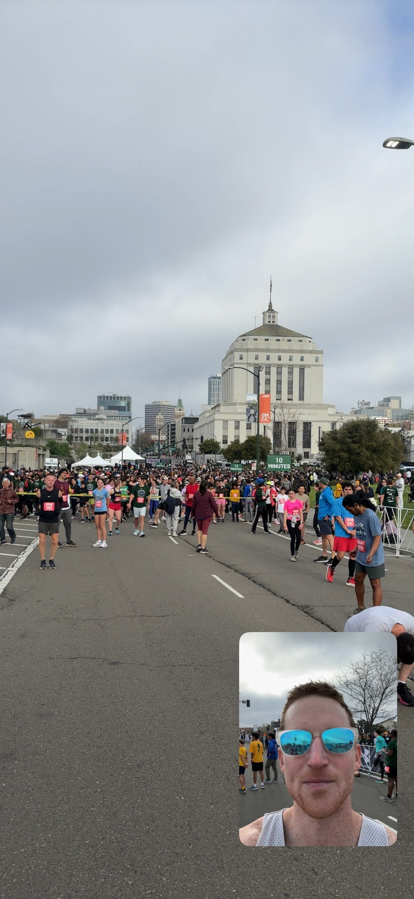
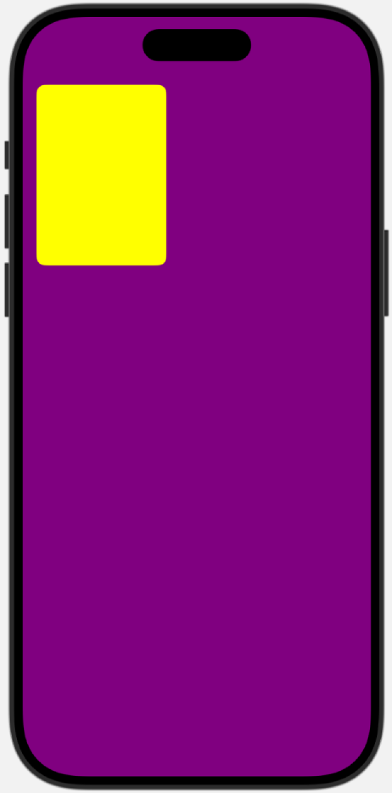
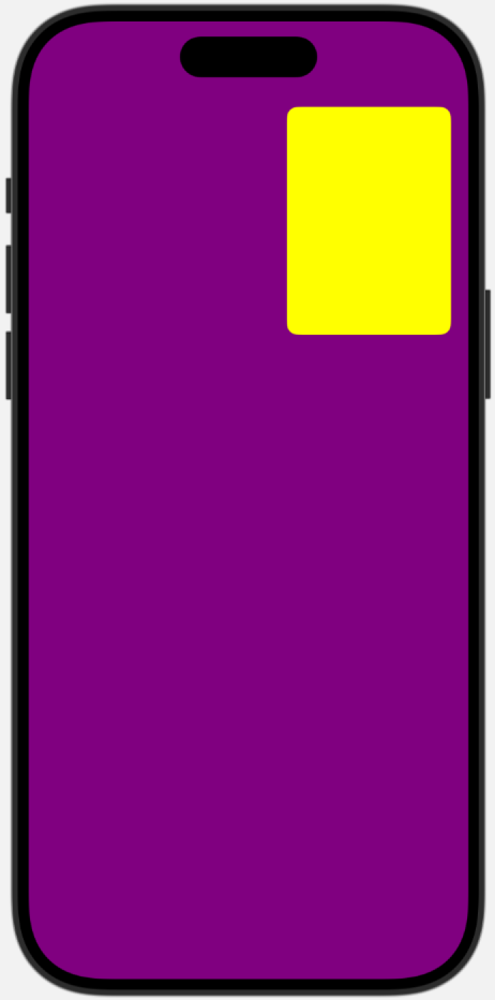
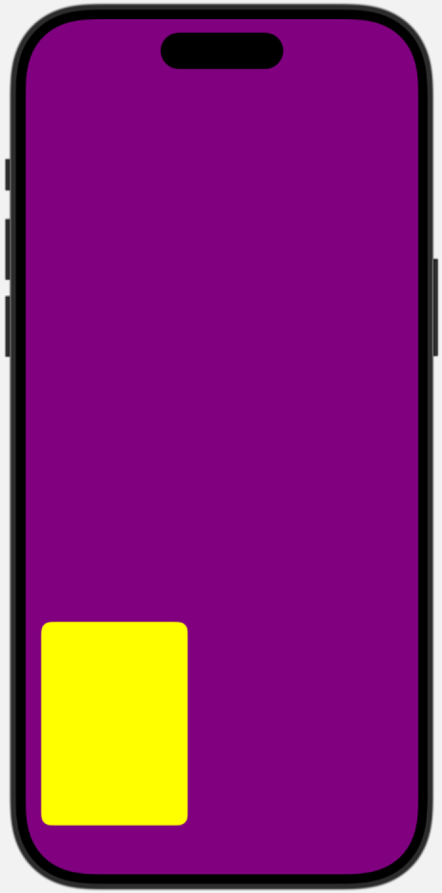
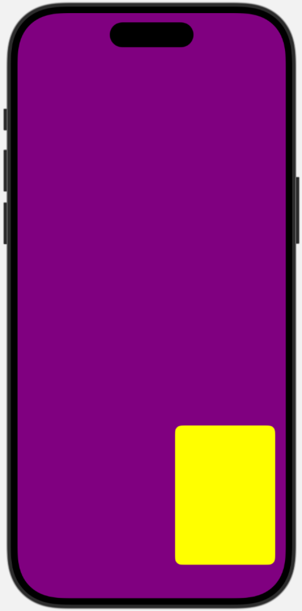
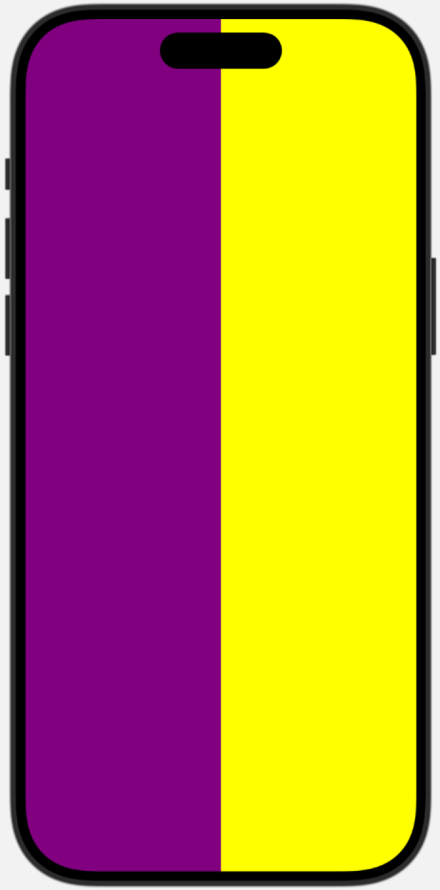
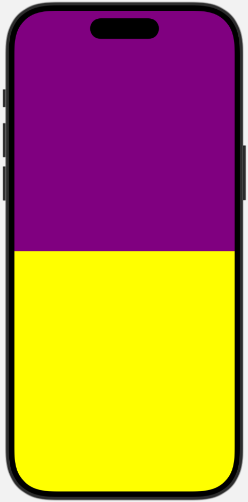

# DualCameraKit

[](https://github.com/Liampronan/DualCameraKit/actions/workflows/swift.yml)
[](https://github.com/Liampronan/DualCameraKit/blob/main/Package.swift)
[](https://github.com/Liampronan/DualCameraKit/blob/main/Package.swift)


Photo-first simultaneous front and back camera capture for iOS.

`DualCameraKit` uses `AVCaptureMultiCamSession` to run front and back cameras at the same time, renders them with Metal, and captures composed still images from the latest camera frames.

v0.5 intentionally ships a tight photo-only surface; video recording is not part of this release, with a dedicated video prototype planned next.

<table>
<tr>
  <td align="center" width="33%">
    <br>
    <b>Photo Capture</b>
  </td>
  <td align="center" width="34%">
    
    
    <br>
    
    
    <br>
    <b>Composable Layouts</b>
  </td>
  <td align="center" width="33%">
    <br>
    <b>Video Prototype</b><br>
    <sub>Coming soon</sub>
  </td>
</tr>
</table>

## Status

| Category | Status | Description |
| --- | :---: | --- |
| Camera streams | ✅ | Separate front and back `AVCaptureVideoDataOutput` streams over bounded latest-frame subscriptions. |
| Display | ✅ | SwiftUI dual-camera display with PiP, side-by-side, and vertical layouts. |
| Photo capture | ✅ | Composes the latest front/back camera frames using the same layout resolver as display. |
| Drop-in UI | ✅ | `DualCameraScreen` provides a ready-to-use photo capture screen. |
| Video capture | Prototype coming soon | Removed from v0.5 to keep the production API focused; a future release can add a dedicated video product. |

## Installation

Add the package URL in Xcode with **File > Add Packages...**, then choose the product you need:

- `DualCameraKit` for the core controller, display view, renderer, layout, photo capture, and save strategy APIs.
- `DualCameraKitUI` for the drop-in `DualCameraScreen` and bundled controls.

Or add it from `Package.swift`:

```swift
dependencies: [
    .package(url: "https://github.com/Liampronan/DualCameraKit.git", from: "0.5.0")
],
targets: [
    .target(
        name: "YourTarget",
        dependencies: ["DualCameraKit", "DualCameraKitUI"]
    )
]
```

## Requirements

- iOS 17+
- A physical device for live dual-camera capture
- `NSCameraUsageDescription` in your app's `Info.plist`
- `NSPhotoLibraryAddUsageDescription` only if you use `.photoLibrary(service:)`

The simulator uses a mock stream source so previews and UI integration can run without camera hardware. See [Simulator and Test Fixtures](#simulator-and-test-fixtures) to swap the default animated colours for deterministic images.

## Usage

### Drop-in Screen

```swift
import DualCameraKitUI
import SwiftUI

struct ContentView: View {
    var body: some View {
        DualCameraScreen()
    }
}
```

Customize the screen by passing a view model:

```swift
import DualCameraKit
import DualCameraKitUI

let viewModel = DualCameraViewModel(
    layout: .sideBySide,
    photoSaveStrategy: .custom { image in
        upload(image)
    },
    showSettingsButton: true
)

struct ContentView: View {
    var body: some View {
        DualCameraScreen(viewModel: viewModel)
    }
}
```

### Compositional Display

Use `DualCameraDisplayView` and `DualCameraController` when you want your own controls:

```swift
import DualCameraKit
import SwiftUI

struct CameraComposer: View {
    @State private var controller = DualCameraController()
    @State private var capturedImage: UIImage?
    @State private var displaySize: CGSize = .zero
    let layout: DualCameraLayout = .piP(miniCamera: .front, miniCameraPosition: .bottomTrailing)

    var body: some View {
        ZStack(alignment: .bottom) {
            DualCameraDisplayView(
                controller: controller,
                layout: layout,
                onDisplaySizeChange: { displaySize = $0 }
            )
            .ignoresSafeArea()

            Button("Capture") {
                Task {
                    capturedImage = try await controller.capturePhoto(
                        layout: layout,
                        outputSize: displaySize
                    )
                }
            }
        }
        .task {
            try? await controller.startSession()
        }
        .onDisappear {
            controller.stopSession()
        }
    }
}
```

Capture with the size from `onDisplaySizeChange` so the photo matches the preview. When the display view ignores the safe area, a `GeometryReader` around it reports the smaller safe-area size, and the photo comes out shorter than the screen with the PiP in a different spot.

### Diagnostics and Camera Controls

Subscribe to diagnostic events when you need runtime visibility into capture health:

```swift
let controller = DualCameraController(diagnosticEventHandler: { event in
    print("Dual camera event:", event.kind)
})

let snapshot = controller.diagnosticsSnapshot()
```

Diagnostics use a small event taxonomy covering dropped synchronized frame pairs, fallback captures, oversized fallback frame gaps, session interruptions, configuration failures, unsupported controls, adjusted controls, and control failures.

Per-camera controls expose both capabilities and application results:

```swift
let capabilities = try controller.cameraCapabilities(for: .back)

if capabilities.zoom.isSupported {
    let result = try controller.applyZoomFactor(3, for: .back)

    if case .adjusted(_, let applied) = result {
        print("Zoom was clamped to", applied)
    }
}

try controller.applyTorchMode(.on, for: .back)
```

### Dependency Injection

Use `DualCameraDependencies` when composing the bundled UI with explicit services:

```swift
let dependencies = DualCameraDependencies(
    mediaLibraryService: .noop,
    dualCameraController: DualCameraController()
)

let viewModel = DualCameraViewModel(dependencies: dependencies)
```

### Simulator and Test Fixtures

`DualCameraDependencies.makeDefaultCameraController()` uses `DualCameraMockCameraStreamSource(animated: true)` in the Simulator: flat colours whose hue changes every 250 ms. That is enough to see a screen run, but it cannot show a crop, offset or aspect-ratio bug. For those, give the controller a still fixture instead:

```swift
// Built-in test pattern: grid, TL/TR/BL/BR corner markers, centre crosshair, FRONT/BACK label.
let controller = DualCameraController(streamSource: DualCameraMockCameraStreamSource.testPattern())

// Your own stills, one per camera. Frames use each image's pixel size.
let controller = DualCameraController(
    streamSource: DualCameraMockCameraStreamSource(front: frontFixture, back: backFixture)
)

// Or a provider, called with the camera and a frame index (0 on start; 1, 2, … every 250 ms when animated).
let controller = DualCameraController(
    streamSource: DualCameraMockCameraStreamSource(animated: false) { source, frameIndex in
        source == .front ? frontFixture : backFixture
    }
)
```

Still fixtures are published once per `startSession()`, so every capture gets the same pixels. To use one across the bundled UI, pass it through `DualCameraDependencies(makeDualCameraController:)`, for example behind a launch argument in UI tests.

`DualCameraTestPattern` exposes the pattern's marker rectangles and colours (`markerRect(for:in:)`, `Corner.color`, `backgroundColor(for:)`) so tests can sample captured images: a missing corner marker means that side was cropped, and a crosshair off the centre of its region means the frame was offset.

**Frame sizes.** The live `DualCameraCameraStreamSource` sets a 32BGRA pixel format and rotates each connection to portrait, but it does not choose a session preset or `activeFormat`, so each camera streams at its device's default format, which varies by iPhone model and is not documented. The 4:3 formats iPhone cameras commonly default to arrive as portrait 3:4 frames, so `testPattern()` defaults to `DualCameraTestPattern.portrait3x4FrameSize` (1080×1440). Pass `frontFrameSize:` / `backFrameSize:` (for example `DualCameraTestPattern.portrait9x16FrameSize`) to match other devices or to test both. On a device, the live source logs each camera's active format under the `DualCameraKit` subsystem, `Camera` category, so you can confirm what your target hardware uses. The default animated mock still renders 360×640 points (9:16), which can hide bugs that only show with 3:4 frames.

## Layouts

```swift
public enum DualCameraLayout {
    case sideBySide
    case stackedVertical
    case piP(miniCamera: DualCameraSource, miniCameraPosition: MiniCameraPosition)
}
```

The same `DualCameraLayoutResolver` drives display placement and captured photo composition.

## Demo App

The demo app lives in this repository on purpose. It exercises the local package and includes three focused examples:

- Drop-in full-screen photo capture
- Container photo capture with review overlay
- Custom compositional UI using `DualCameraDisplayView` + `DualCameraController`

To run it, open `DualCameraKit.xcworkspace`, select the `DualCameraDemo` scheme, set your development team, and run on a device for real camera capture.

## Limitations

- v0.5 is photo-only.
- Live capture requires a physical device that supports multi-cam.
- Simulator support is mock-driven. Use `DualCameraMockCameraStreamSource.testPattern()` or image fixtures to check layout and capture geometry; mock frames do not reproduce device colour, timing or format differences.
- iPad and audio/video capture are future work.

## References

Part of this project was adapted from Apple's [`AVMultiCamPiP: Capturing from Multiple Cameras`](https://developer.apple.com/documentation/avfoundation/avmulticampip-capturing-from-multiple-cameras). This package keeps front and back camera frames as separate streams so layout and capture can be controlled by the library.

## License

This project is available under the [MIT License](LICENSE.md).
